<div align="center">

# 🛡️ SentinelQA

**An AI-assisted test automation platform in Java: UI, API, database, performance and security testing in one repo,
with AI that repairs broken locators, triages failures, drafts tests and joins the pentest.**


</div>

> **In plain words:** ShopLite is a small online shop, and SentinelQA is its robot QA team. One robot clicks
> through the site like a customer, one checks the server's answers, one inspects the database, one acts as hundreds
> of shoppers at once, and one tries to hack the shop. When the page changes, AI repairs the robots. When a test
> fails, AI explains why. The same robots also test a real, live e-commerce site on the internet.

---

## 📑 Contents

1. [At a glance](#-at-a-glance)
2. [Architecture goals](#-architecture-goals)
3. [System architecture](#-system-architecture)
4. [Framework design](#-framework-design)
5. [System under test: ShopLite](#-system-under-test-shoplite)
6. [Test strategy](#-test-strategy)
7. [Types of testing](#-types-of-testing)
8. [AI layer](#-ai-layer)
9. [CI/CD pipeline](#-cicd-pipeline)
10. [Reporting and observability](#-reporting-and-observability)
11. [Tech stack](#-tech-stack)
12. [Getting started](#-getting-started)
13. [The 5-minute demo](#-the-5-minute-demo)
14. [Project layout](#-project-layout)
15. [Architecture decisions and trade-offs](#-architecture-decisions-and-trade-offs)
16. [Known limitations and roadmap](#-known-limitations-and-roadmap)

---

## 📊 At a glance

| | |
|---|---|
| **152 automated test cases** | 98 test methods, many data-driven: 108 regression cases on ShopLite (UI, API, DB, security) and 44 on a live third-party site |
| **1 real vulnerability found** | The expanded security suite caught ShopLite leaking session ids in URLs (CWE-598). Fixed and now guarded by a test |
| **6 kinds of testing** | UI · API · Database · Security · Load · Stress |
| **3 browsers** | Chrome, Firefox, Edge: locally, on Selenium Grid (Docker), or on a standalone Grid (JDK only) |
| **4 planted defects** | A CI job proves the suite catches every one of them (*tests have teeth*) |
| **4 AI capabilities** | Self-healing locators · failure triage · test generation · AI pentest (Strix) |
| **AI is optional** | No API key? Everything still runs as a plain Selenium/TestNG suite |
| **Free LLMs** | Any OpenAI-compatible endpoint: OmniRoute, OpenRouter `:free`, Groq, Gemini, Ollama |
| **2 ways to run** | Docker Compose, or **JDK only** (embedded PostgreSQL, no Docker at all) |

---

## 🎯 Architecture goals

The project is designed as an automation **platform**, not just a set of scripts. Each goal maps to a concrete design choice:

| Goal | How it is achieved |
|---|---|
| **Reusable** | App-agnostic framework in `qa-tests/src/main`, app-specific page objects and tests in `src/test`. The same framework tests both ShopLite and a live third-party site without changes |
| **Trustworthy** | Every layer verifies the others (UI ↔ DB, UI ↔ API). Planted defects prove the tests can fail. Flaky-prone patterns (sleeps, shared state) are avoided by design |
| **Scalable** | ThreadLocal WebDriver plus TestNG parallel methods; Selenium Grid for cross-browser fan-out |
| **AI with guardrails** | AI accelerates and never decides alone: healed locators must match exactly one element, AI errors can never fail a build, generated tests are drafts |
| **Legal and ethical** | Load and security testing only run against the system we own. The live site gets functional tests only |
| **Easy to demo** | One `.env` drives the app, tests and scanners. Two toggles switch on planted bugs or a "UI redesign" |
| **Portable** | Runs with Docker, without Docker, and on GitHub Actions |

---

## 🏗️ System architecture

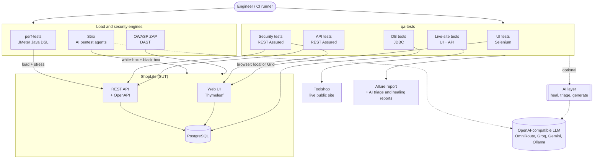

**Three Maven modules, one aggregator POM.** Each module owns its own dependencies, because heavy or conflicting
stacks must not leak into each other (JMeter ships Groovy 3, REST Assured needs Groovy 4+).

| Module | Role |
|---|---|
| `shoplite/` | The system under test: Spring Boot 4 web shop with a UI, a REST API and PostgreSQL |
| `qa-tests/` | The automation framework (`src/main`) plus the UI, API, DB, security and live-site suites (`src/test`) |
| `perf-tests/` | Load and stress tests written as code with JMeter Java DSL (also exportable as `.jmx`) |

### Runtime topology

The whole stack runs in two interchangeable ways. The tests don't know or care which one is used: ports, database
name and credentials are identical.

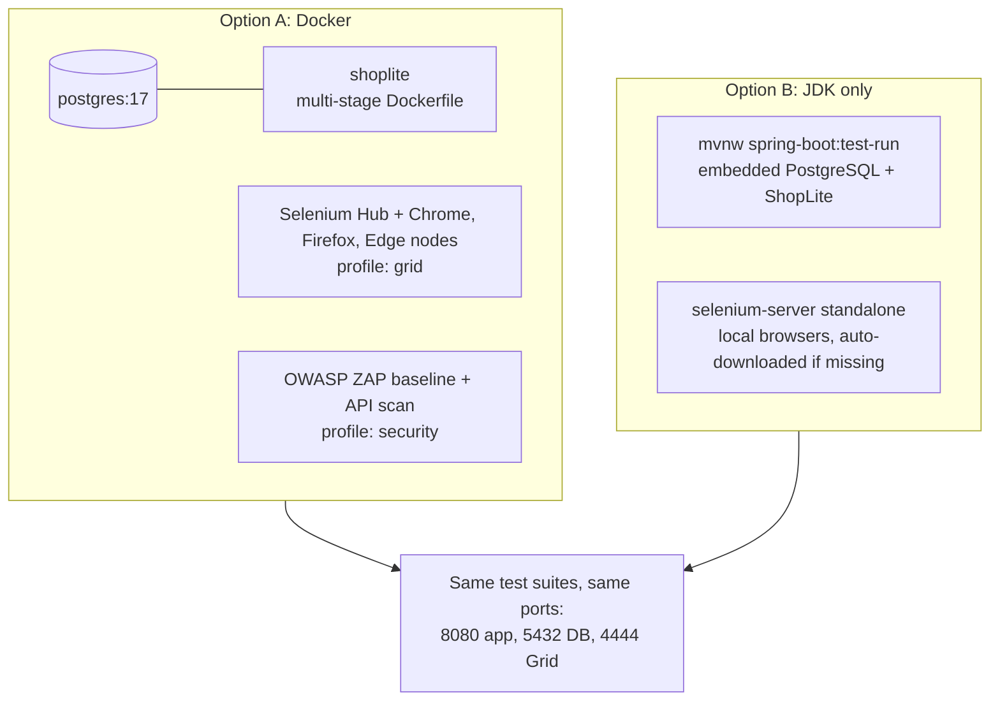

---

## 🧩 Framework design

The framework is layered so that **tests read like business scenarios**, page objects hide the UI mechanics, and the
core is fully reusable for any other web application.

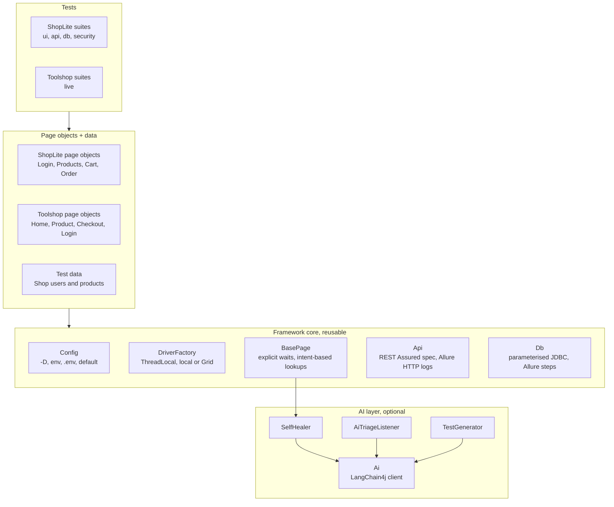

### Key design patterns

| Pattern | Where | Why it matters |
|---|---|---|
| **Page Object Model** | `pages/`, `live/pages/` | Tests describe *what*, page objects own *how*. A UI change is fixed in one place |
| **Intent-based locators** | `BasePage.find(locator, "submit button of the login form")` | Every lookup carries a plain-English purpose. That makes failures readable and gives the AI healer the context it needs |
| **ThreadLocal WebDriver** | `DriverFactory` | One browser per test thread, so TestNG can run methods in parallel safely |
| **Explicit waits only** | `BasePage`, page objects | No `Thread.sleep`. Waits on visibility, URL, clickability or app "done" markers |
| **Single config source** | `Config` | `-Dkey` → `ENV_VAR` → `.env` → default. One `.env` configures app, tests and scanners |
| **Listener-based cross-cutting** | `AiTriageListener` (registered with `ServiceLoader`) | Screenshots and AI triage happen for every test without any test code |
| **Data-driven tests** | TestNG `@DataProvider` (credentials, payloads, boundaries, sort orders) | One test method, many cases: each row is reported separately, and adding coverage is one line of data |
| **Fluent page flows** | `checkout.signInAndContinue(...).billingAddress(...).payWith(...)` | Long journeys read top to bottom like the user story |
| **Specification reuse** | `Api.given()`, `Toolshop.api()` | JSON, BigDecimal money, Allure logging configured once, overridden per target |

### Configuration resolution

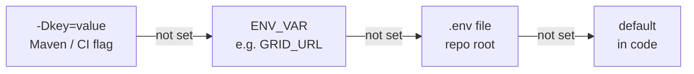

| Key | Default | Purpose |
|---|---|---|
| `base.url` / `ui.base.url` | `http://localhost:8080` | Where API tests and browsers reach the app (they differ when browsers run inside Grid containers) |
| `browser` · `headless` · `grid.url` | `chrome` · `true` · *(empty = local)* | Browser selection and execution mode |
| `ui.timeout.seconds` | `8` | Explicit wait timeout |
| `db.url` · `db.user` · `db.password` | local PostgreSQL | JDBC verification target |
| `ai.base.url` · `ai.api.key` · `ai.model` | *(empty = AI off)* | Any OpenAI-compatible LLM endpoint |
| `toolshop.url` · `toolshop.api.url` | practicesoftwaretesting.com | Live-site targets |
| `parallel` · `threadCount` | `methods` · `4` | TestNG parallelism (`-Dparallel=none` to watch tests one by one) |

---

## 🛒 System under test: ShopLite

We **own the system under test** on purpose: load, stress and security testing are only legal against systems you are
authorised to test. ShopLite ships in the repo and resets to known seed data with one command.

| Aspect | Details |
|---|---|
| Stack | Spring Boot 4.1 · Spring MVC · Thymeleaf · JdbcClient · Flyway · PostgreSQL · springdoc OpenAPI |
| Web UI | `/login` · `/products?q=` · `/cart/add` · `/cart` · `/checkout` · `/orders` · `/orders/{id}` · `/logout` |
| REST API | `POST /api/auth/login` · `GET /api/products[?q=]` · `GET /api/products/{id}` · `POST /api/orders` · `GET /api/orders` · `GET /api/orders/{id}` |
| Ops | `/actuator/health` · `/v3/api-docs` · `/swagger-ui.html` |
| Security | BCrypt password hashes · bearer tokens for the API · hardening headers (CSP, X-Frame-Options, nosniff) · `SameSite=Lax` session cookie |
| Demo toggles | `SHOPLITE_DEFECTS=true` plants 4 real bugs · `SHOPLITE_REDESIGN=true` renames buttons to break locators |

### Data model

The database enforces its own rules (CHECK constraints, foreign keys), and the DB test suite verifies they hold.

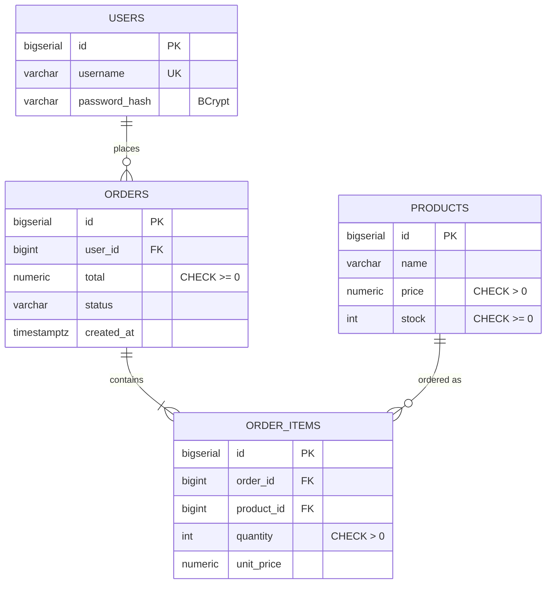

### Planted defects (`SHOPLITE_DEFECTS=true`)

| # | Defect | OWASP / category | Caught by |
|---|---|---|---|
| 1 | SQL injection in product search: a UNION leaks password hashes | A03 Injection | `SecurityRegressionTest`, Strix, ZAP active scan |
| 2 | IDOR: any user can read any order via `/api/orders/{id}` | A01 Broken Access Control | `SecurityRegressionTest`, Strix |
| 3 | Missing security headers (CSP, X-Frame-Options, nosniff) | A05 Security Misconfiguration | `SecurityRegressionTest`, ZAP baseline |
| 4 | Stock not decremented when an order is placed | Data integrity | `DataIntegrityTest` (invisible in the UI, caught in SQL) |

---

## 🧪 Test strategy

The suite follows the **test pyramid**: most checks run at the fast, stable API and DB layers, while the UI layer covers
the critical user journeys end to end. Every UI journey also verifies the backend, so a green UI test means the data
is right too, not just the screen.

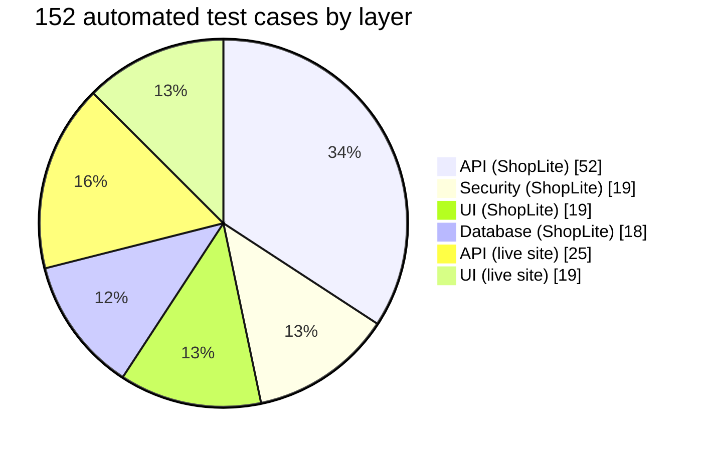

| Principle | In practice |
|---|---|
| **Layers verify each other** | The UI checkout asserts against PostgreSQL. The live-site checkout asserts the UI's invoice number against the backend API |
| **Prove tests can fail** | CI runs the suite against a known-bad build and fails if nothing goes red |
| **Scanners discover, tests guard** | ZAP and Strix findings become fast, deterministic regression tests |
| **Assert rules, not snapshots** | Shared or changing data is checked by invariants (sorted, matching, totals add up) |
| **Isolated test data** | Each test owns its data (e.g. a reserved product for stock checks, a dedicated `shopper` account for perf traffic) |
| **Boundaries and negatives** | Quantity 0 / 1 / 100 / 101, wrong credentials, malformed JSON, bad auth headers | Most bugs live at the edges, and every error path must return a precise 4xx, never a 500 |
| **Groups, not folders** | TestNG groups `ui · api · db · security · live`: run any slice with `-Dgroups=` |

### Tests have teeth

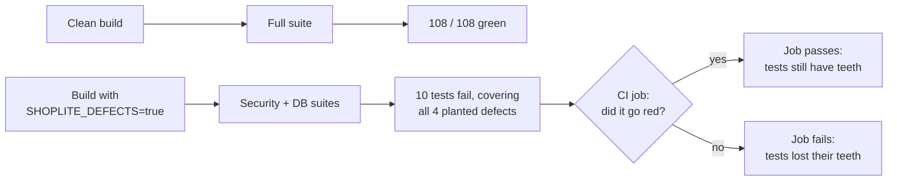

---

## 🔬 Types of testing

### 1. UI testing (Selenium WebDriver)

Real browser journeys, built on the Page Object Model, run in parallel and across browsers.

- **Cross-browser:** Chrome, Firefox and Edge, run locally (Selenium Manager resolves drivers) or on Selenium Grid.
- **Parallel and isolated:** a ThreadLocal driver per thread, a fresh browser per test, closed in `@AfterMethod`.
- **Cross-layer verification:** the checkout test reads the stored order back through JDBC.
- **Failure evidence:** a screenshot is attached to Allure automatically on every failure.
- **Robust synchronisation:** waits on app state (cart counter, URL, "done" markers), never on time. Three
  consecutive full runs of the suite are green.
- **Coverage:** login and logout, access control, search, cart rules (merging, totals), checkout and order history.

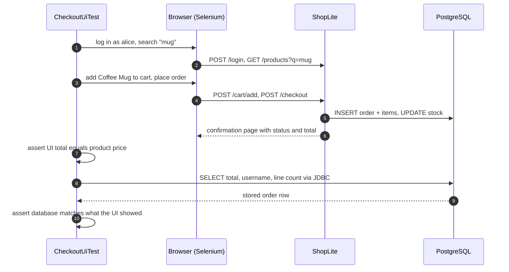

### 2. API testing (REST Assured)

Contract, functional, auth and negative-path coverage on the REST API, with every request and response logged into Allure.

- **Contract testing:** responses are validated against JSON Schemas (`src/test/resources/schemas`).
- **Exact money:** JSON numbers are parsed as `BigDecimal`, so totals are compared without floating-point error.
- **Negative paths:** 400 validation, 401 auth, 404 not found and 409 out-of-stock are all asserted.
- **Boundary values:** quantities 1 and 100 are accepted, while 0, -1 and 101 are rejected.
- **Data-driven:** wrong credentials, incomplete requests, bad `Authorization` headers and malformed orders are tables of cases.
- **No user enumeration:** an unknown user and a wrong password get the same message.

### 3. Database testing (JDBC + PostgreSQL)

Checks what the UI and API did is what actually got stored, and that the schema protects itself.
Every query is parameterised and shows up as a readable Allure step.

- **Transactions:** a multi-line order that fails on its last line rolls back *all* stock changes
- **Concurrency:** two customers race for the last posters at the same moment. Exactly one order may win, so stock
  can never be oversold (proves the row-level `UPDATE … WHERE stock >= ?` guard)
- **Consistency:** the API response equals the stored rows, totals equal the sum of their lines, no empty orders,
  line prices match the catalogue
- **Schema self-defence:** CHECK, UNIQUE and FOREIGN KEY constraints are asserted by SQLState (`23514`, `23505`, `23503`),
  cascade delete works, and the required indexes exist
- **Reference data and secrets:** seed catalogue intact, Flyway migrations applied, passwords stored as BCrypt hashes

### 4. Security testing (defence in depth)

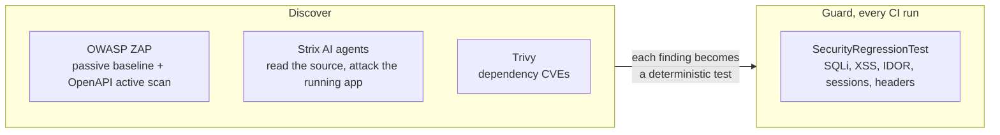

| Tool | Type | When |
|---|---|---|
| `SecurityRegressionTest` | Deterministic regression (Java) | Every push / PR |
| OWASP ZAP | DAST: passive baseline + active scan of the OpenAPI spec | Nightly / manual |
| Trivy | SCA: dependency vulnerability scan (CRITICAL, HIGH) | Nightly / manual |
| Strix | AI pentest: autonomous white-box + black-box agents | Manual (uses LLM tokens) |

`SecurityRegressionTest` covers the OWASP Top 10 areas that matter for a shop: **injection** (4 SQL injection techniques,
reflected XSS), **broken access control** (IDOR on both API and web pages, login-protected pages), **authentication
and sessions** (HttpOnly + SameSite cookie, session id rotation on login, logout invalidation) and **misconfiguration**
(hardening headers on every kind of response, no stack traces in errors).

> **A real finding.** When the suite was expanded, `protectedPagesRequireLogin` failed on the *clean* build: ShopLite
> redirected to `/login;jsessionid=…`, putting the session id in the URL, where it leaks through browser history,
> server logs and the `Referer` header (CWE-598). It was a framework default nobody had planted. The fix is
> `server.servlet.session.tracking-modes=cookie`, and the test now guards it. This is exactly why the suite exists.

### 5. Performance testing: load and stress (JMeter Java DSL)

Performance tests are **code**: versioned, reviewed and run in CI like any other test. Each plan is also saved as
`.jmx`, so it opens in the JMeter GUI. Both tests replay the same realistic journey:

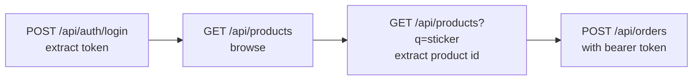

**Load test: SLA gate.** Ramps to the expected peak and fails the build if **p95 > 800 ms** or **errors > 1 %**.
It produces the JMeter HTML dashboard and a per-request p95 breakdown.

**Stress test: find the breaking point.** Steps the load up until the app breaks, then reports its capacity:

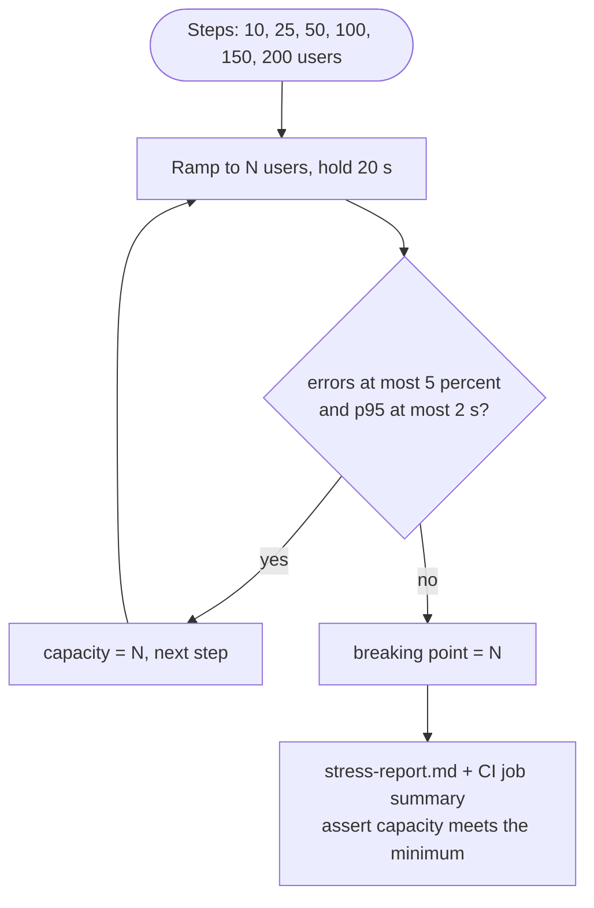

| Measured on a developer laptop | Result |
|---|---|
| Load, 10 users | 0 % errors, p95 ≈ 220 ms |
| Stress | Capacity ≈ 50 users, breaks at 150; throughput plateaus ≈ 220 req/s |
| Bottleneck found | Login: BCrypt hashing is CPU-bound (deliberate, and visible in the per-request breakdown) |

### 6. Live-site testing: a real, public e-commerce site

The same framework, unchanged, tests a site we did not build:
**[Toolshop (practicesoftwaretesting.com)](https://practicesoftwaretesting.com)**, an Angular shop with a public REST API,
made for automation practice. This shows the framework is portable beyond its own demo app.

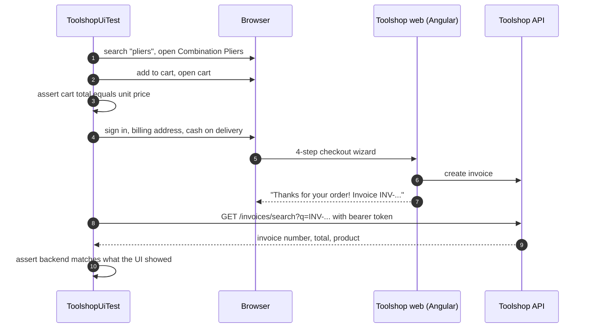

**Ground rules for testing a site we don't own:** functional tests only, at a human pace (at most 2 tests at a time). **No load or security
scans.** The data is shared with everyone practising on the site, so tests assert *rules*, never exact catalogue
contents. The `live` group is excluded from the default run and runs in CI on demand only, so a third-party outage
can't turn our pipeline red. (Sites like Amazon are deliberately not used: their terms ban automated access.)

<details>
<summary><b>📋 Full test catalogue (98 test methods → 152 test cases)</b></summary>

Counts are test **cases**: a data-driven method (TestNG `@DataProvider`) runs once per data row.

**ShopLite: UI** (`-Dgroups=ui`, 19 cases)
| Class | Cases | Verifies |
|---|---|---|
| `LoginUiTest` | 7 | Both customers log in under their own name · wrong password, unknown user and wrong-case username show one generic error · logout ends the session · anonymous visitors are sent to login |
| `SearchUiTest` | 5 | Search matches ignoring case (3 terms) · "no results" message · the catalogue page lists exactly the products in the database |
| `CartUiTest` | 4 | New session has an empty cart · adding confirms by name and updates the counter · same product twice merges into one line · cart total is the sum of line subtotals |
| `CheckoutUiTest` | 3 | Full checkout verified against PostgreSQL · the order appears in the history · checkout empties the cart |

**ShopLite: API** (`-Dgroups=api`, 52 cases)
| Class | Cases | Verifies |
|---|---|---|
| `AuthApiTest` | 19 | Token format and response shape · 5 wrong-credential cases with one generic message (no user enumeration) · 5 incomplete requests are 400, never 500 · tokens are unique · 5 bad `Authorization` headers are 401 · no password hash in responses |
| `ProductApiTest` | 15 | JSON contract · search with 6 terms (case, spaces, partial words) · no-match is an empty list · API count equals DB count · stable ordering · detail equals list entry · 3 unknown ids are 404 · non-numeric id is 400 |
| `OrderApiTest` | 18 | Totals for single and multi-line orders · duplicate lines merged · unit price recorded · boundary quantities 1 and 100 accepted · 0, -1 and 101 rejected · 4 malformed orders refused with precise codes · auth required · out-of-stock is 409 · read-back · history newest first · history is private |

**ShopLite: Database** (`-Dgroups=db`, 18 cases)
| Class | Cases | Verifies |
|---|---|---|
| `DataIntegrityTest` | 18 | Migrations applied · seed catalogue intact · required indexes exist · stock decrements · API response equals stored rows · **failed orders roll back completely** · **two concurrent buyers can't oversell** · totals equal line sums · no empty orders · line prices match catalogue · cascade delete · CHECK, UNIQUE and FOREIGN KEY constraints enforced (asserted by SQLState) · BCrypt hashes |

**ShopLite: Security** (`-Dgroups=security`, 19 cases)
| Class | Cases | Verifies |
|---|---|---|
| `SecurityRegressionTest` | 19 | 4 SQL injection techniques (UNION, tautology, comment truncation, error-based) · reflected XSS is escaped · IDOR on API and web pages · 4 pages require login, **with no session id in the URL** · HttpOnly + SameSite cookie · session id rotates on login (no fixation) · logout invalidates the session · hardening headers on 3 kinds of responses · errors leak no stack traces |

**Live site: Toolshop** (`-Plive`, 44 cases)
| Class | Cases | Verifies |
|---|---|---|
| `ToolshopUiTest` | 19 | Full purchase with backend invoice check · search (3 terms) · 4 sort orders · category filter equals the API · product page price equals the API · out-of-stock can't be added · German translation · quantity selector drives the cart total · sign-in · wrong password · login, contact and registration form validation |
| `ToolshopApiTest` | 25 | JSON contract · search (3 terms) · 4 sort orders · pagination · detail equals list · category filter · category tree and brands well-formed · 404 · token format · 4 invalid logins are 401 · profile and invoices need a token · cart add, update, remove · unknown cart 404 |

**Performance** (`perf-tests`)
| Class | Verifies |
|---|---|
| `LoadTest` | Expected peak load meets the p95 and error-rate SLA |
| `StressTest` | Finds the breaking point and requires a minimum capacity |

</details>

---

## 🤖 AI layer

AI is an **accelerator, never a dependency**. All AI goes through one class (`Ai`) that talks to any
OpenAI-compatible endpoint via LangChain4j, at temperature 0, with typed outputs (Java records and enums, not free text).
With `AI_BASE_URL` unset, every AI feature switches off and the suite behaves like a plain Selenium/TestNG suite.

| Capability | How it works | Guardrail |
|---|---|---|
| **Self-healing locators** (`SelfHealer`) | When a locator times out, the element's intent, the broken locator and the cleaned page HTML go to the LLM, which returns a CSS selector | Used **only if it matches exactly one element**. Every heal is logged to Allure and `self-healing-report.md` for a human to fix the page object |
| **Failure triage** (`AiTriageListener`) | Each failed test is classified as `PRODUCT_BUG`, `TEST_BUG`, `ENVIRONMENT` or `FLAKY`, with a confidence, summary and next step | Runs after the test; **any AI error is swallowed**, so AI can never fail a build |
| **Test generation** (`TestGenerator`) | Reads the OpenAPI spec and drafts a REST Assured + TestNG class | Written to `target/` as a **draft**. An engineer decides what goes into `src/test` |
| **AI pentest** (Strix) | Autonomous agents read the source and attack the running app in a Docker sandbox | On demand only (costs tokens). Findings are turned into deterministic regression tests |

### Self-healing flow

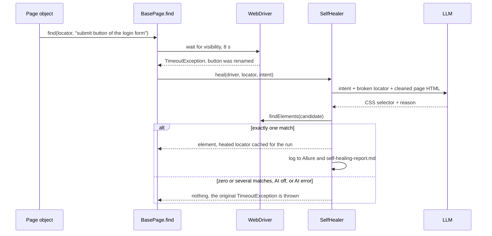

### Failure triage flow

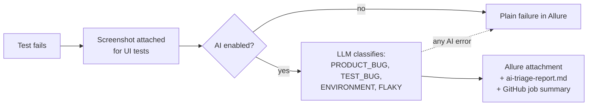

**Free LLM setup:** run [OmniRoute](https://github.com/diegosouzapw/OmniRoute) locally and connect your free-tier
providers in its dashboard. Then set `AI_BASE_URL=http://localhost:20128/v1`, `AI_API_KEY=<key from Dashboard → Endpoints>`
and `AI_MODEL=auto`. OpenRouter (`:free` models), Groq, Gemini and Ollama work the same way. See `.env.example`.
Don't send real customer data or secrets through free tiers, because they may log prompts.

---

## 🚀 CI/CD pipeline

`.github/workflows/ci.yml` runs on GitHub Actions. Fast quality gates run on every change. Slow or costly jobs
run nightly or on demand.

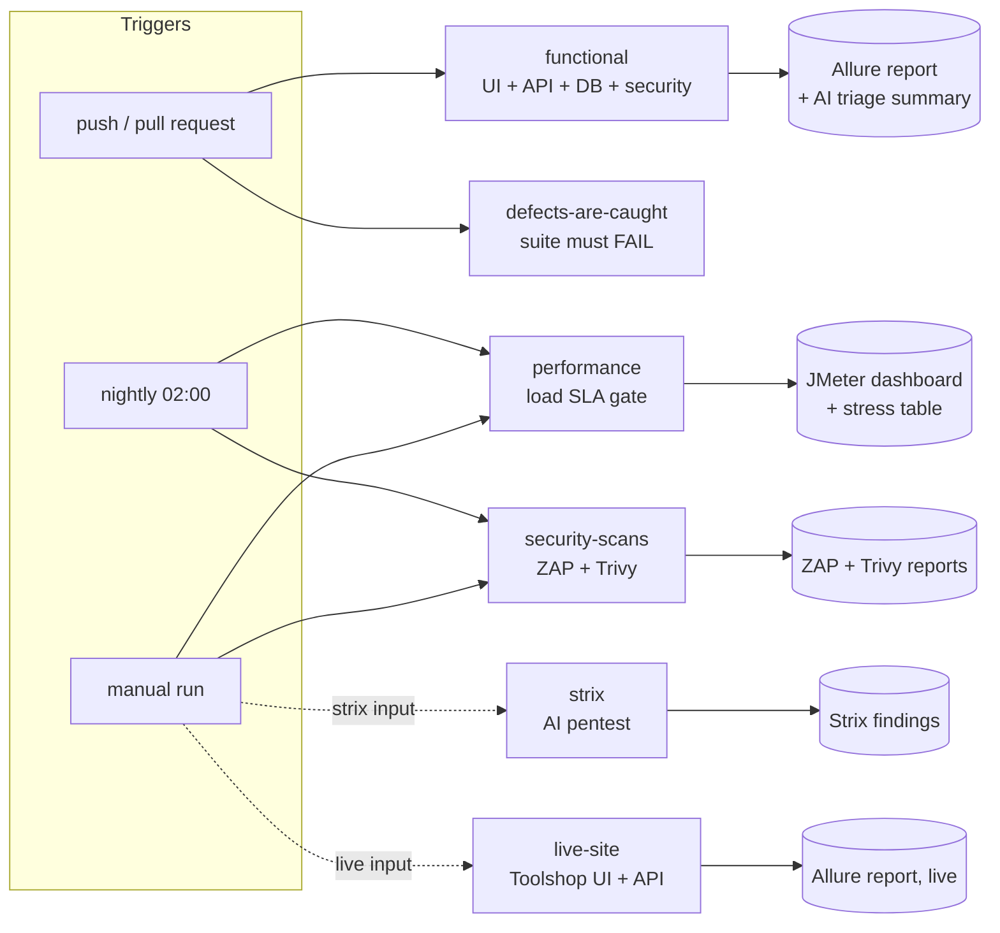

| Job | When | Gate |
|---|---|---|
| UI + API + DB + security regression | Every push / PR | Must pass. Publishes the Allure report and the AI triage summary |
| Planted defects are detected | Every push / PR | The suite **must fail** against the defective build |
| Load (+ optional stress) | Nightly / manual | p95 and error-rate SLA. Stress capacity table in the job summary |
| OWASP ZAP + Trivy | Nightly / manual | Reports uploaded as artifacts |
| Strix AI pentest | Manual | Findings uploaded as an artifact |
| Live site (Toolshop) | Manual | Must pass. Allure report uploaded |

Optional repository secrets: `AI_BASE_URL`, `AI_API_KEY`, `AI_MODEL`, `STRIX_LLM`. Without them, CI runs with AI off.
Third-party actions are pinned (Trivy by commit SHA), and the workflow runs with `contents: read` permissions only.

---

## 📈 Reporting and observability

| Output | Where | Contents |
|---|---|---|
| **Allure report** | `qa-tests/target/site/allure-maven-plugin` · `./mvnw -pl qa-tests allure:serve` | Steps, HTTP request/response logs, SQL steps, screenshots, AI triage and healing notes |
| AI triage report | `qa-tests/target/ai-triage-report.md` | One row per failure: category, confidence, summary, next step (also posted to the CI job summary) |
| Self-healing report | `qa-tests/target/self-healing-report.md` | Every `broken locator → healed locator` with the AI's reason |
| JMeter dashboard | `perf-tests/target/jmeter-reports` | Throughput, latency percentiles, errors over time |
| Stress report | `perf-tests/target/stress-report.md` | Capacity table and breaking point |
| ZAP reports | `reports/zap/*.html, *.json` | Passive and active scan findings |
| Strix findings | `strix_runs/` | Vulnerabilities with proof-of-concept requests |

---

## 🧰 Tech stack

| Area | Technology | Version | Used for |
|---|---|---|---|
| Language | Java (Temurin / Oracle JDK) | 21 target | Everything |
| Build | Maven via wrapper (`mvnw`) | 3.9 | Multi-module build, no local Maven needed |
| UI automation | Selenium WebDriver + Selenium Manager | 4.53 | Browser automation, driver and browser provisioning |
| Distributed UI | Selenium Grid (Docker images or standalone jar) | 4.52 / 4.53 | Cross-browser and parallel execution |
| Test runner | TestNG | 7.12 | Groups, parallelism, listeners |
| API testing | REST Assured + JSON Schema Validator | 6.3 | API and contract tests |
| Database | JDBC + PostgreSQL driver | 42.7 | Data integrity checks |
| Performance | JMeter Java DSL (Apache JMeter) | 2.3 | Load and stress tests as code |
| Security | OWASP ZAP · Trivy · Strix | latest · 0.36 action · latest | DAST · SCA · AI pentest |
| AI | LangChain4j (OpenAI-compatible client) | 1.23 | Self-healing, triage, generation |
| Reporting | Allure (TestNG + REST Assured integrations) | 3.1 | Rich test reports |
| System under test | Spring Boot · Thymeleaf · Flyway · springdoc OpenAPI | 4.1 | ShopLite web shop |
| Data | PostgreSQL (Docker) / embedded PostgreSQL (zonky, test scope) | 17 / 2.2 | Database for ShopLite |
| Containers | Docker Compose (profiles: `grid`, `security`) | | Optional one-command stack |
| CI/CD | GitHub Actions | | Quality gates, nightly perf and security |

---

## ⚡ Getting started

**Prerequisites:** JDK 21+ and Chrome or Edge. Docker is **optional**. Maven isn't needed (the repo ships `mvnw`).
On Windows PowerShell use `.\mvnw.cmd` and set env vars with `$env:NAME="value"`.

### 1. Start ShopLite (pick one)

```bash
cp .env.example .env                                  # optional: AI settings and demo toggles

# Option A: Docker
docker compose up -d --build --wait                   # app on :8080, PostgreSQL on :5432

# Option B: JDK only, no Docker (keep this terminal open, Ctrl+C stops it)
./mvnw -pl shoplite spring-boot:test-run              # embedded PostgreSQL + ShopLite, fresh seed data
SHOPLITE_DEFECTS=true ./mvnw -pl shoplite spring-boot:test-run   # toggles are env vars on this route
```

Open http://localhost:8080 (users `alice / alice123`, `bob / bob123`) and http://localhost:8080/swagger-ui.html.

### 2. Run the tests

```bash
./mvnw -pl qa-tests test                              # all 108 ShopLite test cases, parallel, headless Chrome
./mvnw -pl qa-tests test -Dgroups=api                 # one layer: ui | api | db | security
./mvnw -pl qa-tests test -Dgroups=ui -Dheadless=false -Dparallel=none   # watch the browser, one test at a time
./mvnw -pl qa-tests test -Dbrowser=edge               # chrome | firefox | edge
./mvnw -pl qa-tests test -Plive                       # live Toolshop suite (no ShopLite needed)
./mvnw -pl qa-tests allure:serve                      # open the Allure report

./mvnw -pl perf-tests test -Dtest=LoadTest   -Dperf.users=50 -Dperf.holdSeconds=120
./mvnw -pl perf-tests test -Dtest=StressTest -Dstress.steps=10,25,50,100,200
```

### 3. Selenium Grid (cross-browser)

```bash
# With Docker: watch browsers live at http://localhost:7900 (password: secret)
docker compose --profile grid up -d
./mvnw -pl qa-tests test -Dgroups=ui -Dgrid.url=http://localhost:4444 -Dui.base.url=http://shoplite:8080 -Dbrowser=firefox

# Without Docker: download selenium-server-4.53.0.jar from the Selenium releases page into tools/
java -jar tools/selenium-server.jar standalone --selenium-manager true
./mvnw -pl qa-tests test -Dgroups=ui -Dgrid.url=http://localhost:4444 -Dbrowser=edge
```

### 4. Security scans (Docker)

```bash
docker compose --profile security run --rm zap-baseline     # passive scan     → reports/zap
docker compose --profile security run --rm zap-api          # active API scan  → reports/zap
./security/strix.sh                                          # AI pentest (Linux/WSL, needs an LLM in .env)
```

---

## 🎬 The 5-minute demo

1. **Everything green.** Start ShopLite, run `./mvnw -pl qa-tests test`, then `allure:serve`. Show a UI test that ends
   in a database check, and the HTTP logs on an API test.
2. **Tests have teeth.** Restart with `SHOPLITE_DEFECTS=true` and re-run. SQL injection, IDOR, missing headers and the
   stock bug all go red, and each failure carries an **AI triage** note (product bug vs test bug, plus a next step).
3. **Self-healing.** Restart with `SHOPLITE_REDESIGN=true` (buttons get new ids and labels) and run `-Dgroups=ui` with AI
   on. The tests stay green, and `target/self-healing-report.md` lists every `old → new` locator. With AI off, the same tests fail.
4. **Performance.** Run `LoadTest` and open the JMeter dashboard. Run `StressTest` and read the capacity table: throughput
   plateaus while p95 climbs, and the per-request breakdown points straight at BCrypt login.
5. **AI pentest.** With defects on, `./security/strix.sh` finds the SQL injection and IDOR with proof-of-concept requests.
   `SecurityRegressionTest` is the deterministic guard that keeps them closed.
6. **Real world.** `./mvnw -pl qa-tests test -Plive -Dheadless=false -Dparallel=none`: the same framework buys a product
   on a live public shop and checks the invoice through its API.
7. **AI test generation.** `./mvnw -pl qa-tests compile exec:java` drafts `GeneratedApiTest.java` from `/v3/api-docs`
   into `target/ai-generated` for review.

---

## 📁 Project layout

```
.
├── pom.xml                         Aggregator: shoplite, qa-tests, perf-tests
├── docker-compose.yml              postgres + shoplite · profiles: grid (Hub + 3 browsers), security (ZAP)
├── .env.example                    One config for app, tests and scanners (AI endpoint, demo toggles)
├── .github/workflows/ci.yml        Quality gates, nightly perf + security, on-demand Strix and live suite
│
├── shoplite/                       SYSTEM UNDER TEST: Spring Boot 4 web shop
│   ├── Dockerfile                  Multi-stage build (Maven → JRE)
│   └── src/
│       ├── main/java/…/shoplite    UiController · ApiController · ShopService · SecurityHeadersFilter
│       ├── main/resources          Thymeleaf templates · Flyway migrations (schema + seed)
│       └── test/java/…/LocalShopLite.java   Docker-free launcher (embedded PostgreSQL)
│
├── qa-tests/                       AUTOMATION FRAMEWORK + SUITES
│   └── src/
│       ├── main/java/…/framework   REUSABLE, app-agnostic
│       │   ├── Config              -D → env → .env → default
│       │   ├── ui/                 DriverFactory (ThreadLocal, local/Grid) · BasePage (waits, intents)
│       │   ├── api/                Api (REST Assured spec + Allure logging)
│       │   ├── db/                 Db (parameterised JDBC + Allure steps)
│       │   └── ai/                 Ai · SelfHealer · AiTriageListener · TestGenerator
│       └── test/
│           ├── java/…/pages        ShopLite page objects
│           ├── java/…/tests        ui · api · db · security suites
│           ├── java/…/live         Toolshop page objects + UI/API suites (group "live")
│           └── resources/schemas   JSON Schema contracts
│
├── perf-tests/                     JMeter Java DSL: Journeys · LoadTest · StressTest
└── security/strix.sh               Strix AI pentest runner (white-box + black-box)
```

---

## 🧭 Architecture decisions and trade-offs

| Decision | Alternatives considered | Why this choice |
|---|---|---|
| **Own the system under test** | Public demo sites | Load and security testing are only legal on systems you're authorised to test. Planted defects need control of the code |
| **Plus one live third-party site** | Amazon, Flipkart | Proves real-world portability. Toolshop is built for automation; big retailers forbid it in their terms and block bots |
| **Selenium + TestNG** | Playwright, JUnit 5 | Matches the target Java + Selenium enterprise stack. TestNG groups and listeners fit suite slicing and AI hooks |
| **JMeter Java DSL** | JMeter GUI `.jmx`, Gatling, k6 | Perf tests as reviewable Java code that still exports `.jmx` for JMeter users |
| **Separate perf module** | Single test module | JMeter's Groovy 3 conflicts with REST Assured's Groovy 4+ |
| **OpenAI-compatible LLM via LangChain4j** | Vendor SDK | No vendor lock-in. Free gateways (OmniRoute), cloud free tiers or local Ollama all work |
| **AI optional, guarded, typed** | AI in the critical path | Determinism first: AI output is validated (exactly one match), typed (records and enums), and can never fail a build |
| **Scanners discover, tests guard** | Rely on scanners in CI | Scanners are slow and noisy. Deterministic regression tests are fast and precise |
| **Embedded PostgreSQL for Docker-free runs** | H2 in-memory | The same database engine as production, so SQL injection, SQLStates and constraints behave identically. Test scope only, never in the app image |
| **Parallel by default** | Sequential | Fast feedback. ThreadLocal drivers and per-test data make it safe |

---

## 🗺️ Known limitations and roadmap

**Known shortcuts** (marked `shortcut:` in the code): in-memory API tokens and an N+1 query in ShopLite's order history,
and a 20k-character page cut-off in the self-healer prompt.

**Roadmap**
- [ ] CSRF tokens on ShopLite forms, then switch ZAP from report-only to build-gating
- [ ] Accessibility checks (axe-core) in the UI suite
- [ ] Visual regression snapshots for key pages
- [ ] Benchmark the AI features (heal success rate, triage accuracy) across free models
- [ ] Contract tests between ShopLite's OpenAPI spec and the API suite (consumer-driven)

---

<div align="center">

Built as a portfolio project for the **AI Automation Architect (Java + Selenium)** role.

</div>
